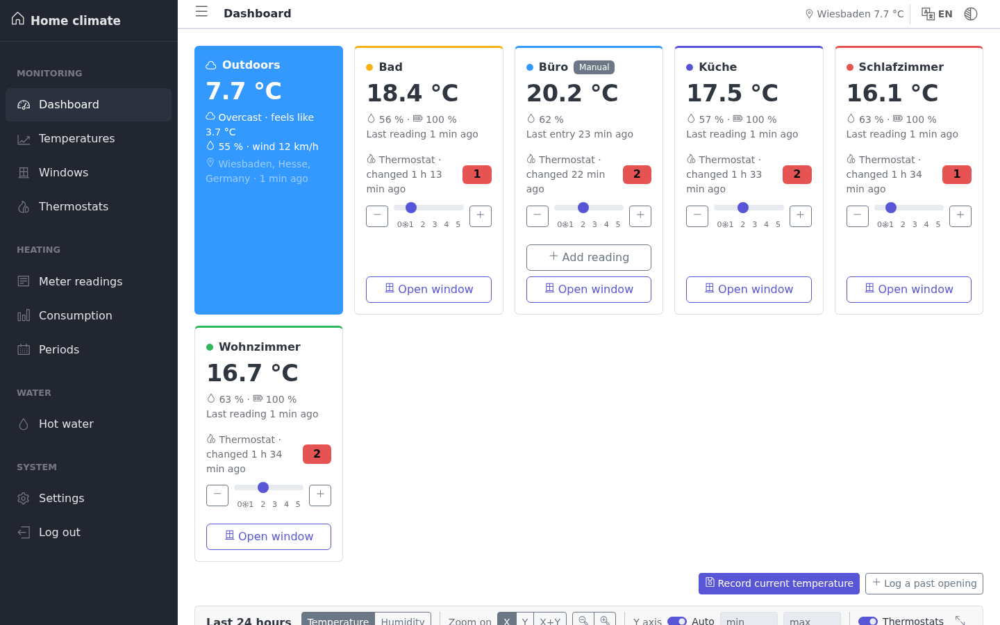
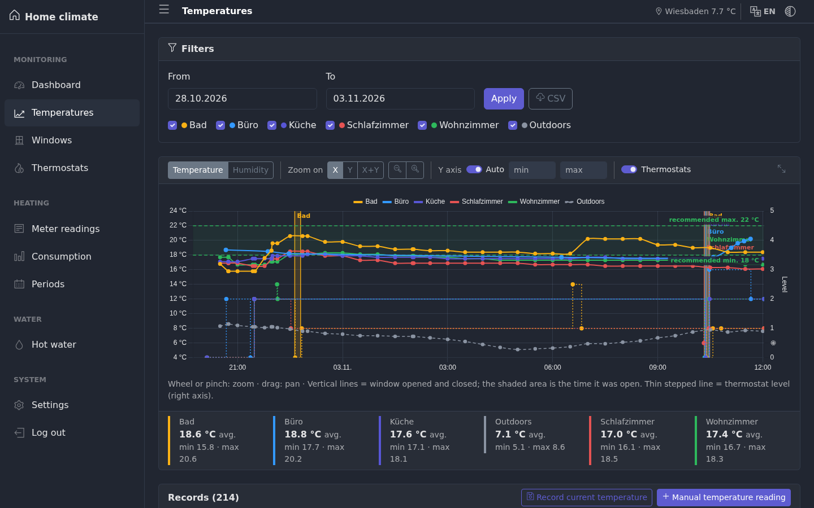
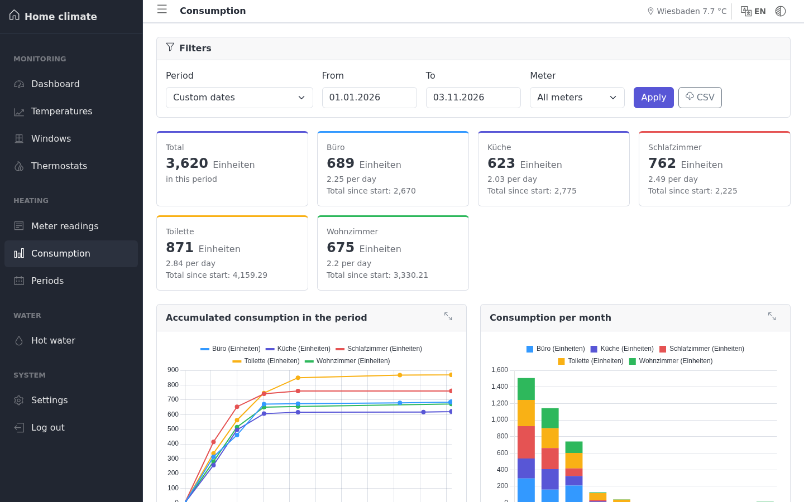

# hausklima


Web dashboard that logs the temperature and humidity of every room in a house using Zigbee sensors.

The sensors publish their readings to Zigbee2MQTT. The dashboard receives them over MQTT, stores them in SQLite and plots them alongside the outdoor temperature from [Open-Meteo](https://open-meteo.com/).

## Features

- Shows the current temperature and humidity of each sensor, plus outdoor conditions (Open-Meteo, based on the configured location).
- Stores readings every N minutes (configurable from the dashboard) and charts them by date range, with zoom.
- Logs when windows are opened and closed, and changes to thermostats.
- Warns in the top bar when a sensor stops reporting, with signal status and an outage log in Settings.
- Shows house metrics: humidity loss and recovery, cooling, and energy per m² from the annual heating bill, for a house or an apartment.
- Supports manual sensors for rooms without a Zigbee sensor.
- Tracks heating and hot water meter readings, with billing periods and consumption calculation.
- Exports temperatures, windows, thermostats and consumption to CSV.
- Available in Spanish, English and German; the language is picked from the browser.
- Password-protected.

## Screenshots

**Dashboard**: current conditions per room, thermostat levels and the last 24 hours.



**Temperatures**: history by date range, with window openings and thermostat levels (dark theme).



**Consumption**: heating meter consumption per period and per month.



## Architecture

```
Zigbee sensors ──► USB dongle ──► zigbee2mqtt ──► mosquitto ──► panel ──► browser
                                     :8081          :1883        :8082
                                                                   │
                                                          datos/clima.db (SQLite)
```

| Service       | Image                        | Host port | Role                                      |
|---------------|------------------------------|-----------|-------------------------------------------|
| `mosquitto`   | `eclipse-mosquitto:2.0.20`   | 1883      | MQTT broker                               |
| `zigbee2mqtt` | `koenkk/zigbee2mqtt:2.6.2`   | 8081      | Zigbee → MQTT bridge, with web UI         |
| `panel`       | local build (`panel/`)       | 8082      | Flask + Waitress, API and static frontend |

The frontend is plain static files (CoreUI, Chart.js, chartjs-plugin-zoom, flatpickr) with no build step. The libraries are vendored in `panel/static/vendor`, so the dashboard loads nothing from a CDN.

## Requirements

- Linux with Docker and the Docker Compose v2 plugin. Tested on a Raspberry Pi running 64-bit Raspberry Pi OS.
- A USB Zigbee coordinator supported by Zigbee2MQTT. This project uses a **SONOFF Zigbee 3.0 USB Dongle Plus MG24** (`ember` adapter).
- Zigbee temperature and humidity sensors.
- Internet access from the host to query Open-Meteo (optional: without it the dashboard still works, but doesn't show the outdoor temperature).

## Installation

1. Clone the repo:

   ```bash
   git clone git@github.com:trucdefou/hausklima.git
   cd hausklima
   ```

2. Create `.env` from the example:

   ```bash
   cp .env.example .env
   chmod 600 .env
   ```

   | Variable         | Description                                                  |
   |------------------|--------------------------------------------------------------|
   | `PANEL_PASSWORD` | Password to log in to the dashboard                          |
   | `ZIGBEE_DONGLE`  | Stable path to the dongle: run `ls /dev/serial/by-id/` to find it |

3. Create the Zigbee2MQTT configuration at `zigbee2mqtt/data/configuration.yaml`. That folder isn't in the repo because it holds the Zigbee network key:

   ```yaml
   homeassistant:
     enabled: false
   mqtt:
     base_topic: zigbee2mqtt
     server: mqtt://mosquitto:1883
   serial:
     port: /dev/ttyACM0   # path inside the container; don't change it
     adapter: ember       # depends on your dongle
   frontend:
     enabled: true
     port: 8080
   availability:
     enabled: true
     passive:
       timeout: 120   # minutes without data before a battery sensor counts as offline
   advanced:
     log_level: info
     last_seen: ISO_8601_local   # real time of each reading
     network_key: GENERATE
     pan_id: GENERATE
     ext_pan_id: GENERATE
   ```

4. Create the data folder before the first start. If Docker creates it, it ends up owned by root and the dashboard (which runs as user 1000) can't write to it:

   ```bash
   mkdir -p datos
   ```

5. Start the services:

   ```bash
   docker compose up -d --build
   ```

6. Pair the sensors from the Zigbee2MQTT UI at `http://<host>:8081` (*Permit join*).

7. Open the dashboard at `http://<host>:8082` and give each sensor a room name. The dashboard settings also let you set the location (for outdoor weather), the logging interval and the reference ranges for temperature and humidity.

## Data

Everything the dashboard generates lives in `datos/`:

| File             | Contents                                                     |
|------------------|--------------------------------------------------------------|
| `clima.db`       | SQLite database with readings, windows, thermostats and meters |
| `config.json`    | Location, room names, interval and ranges                    |
| `.clave_sesion`  | Key used to sign session cookies (created automatically)     |

To back up, copy `datos/` and `zigbee2mqtt/data/`. Without the latter you'd have to pair all the sensors again.

## Security

- Mosquitto accepts anonymous connections (`allow_anonymous true`). It's meant for a local network: don't expose port 1883 to the internet.
- The Zigbee2MQTT UI (8081) has no password.
- The dashboard uses plain HTTP without TLS. To access it from outside your home, use a VPN (WireGuard, Tailscale) or a reverse proxy with HTTPS.

## License

[GNU AGPL v3](LICENSE)
